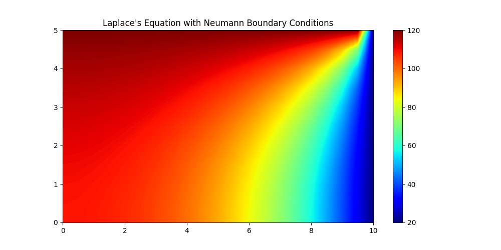

# Numerical Methods for Laplace's Equation on a Rectangular Region


Undergraduate research project — **MATH 496, University of Illinois Chicago (Fall 2022)**
Advised by Prof. Shokouh Pourarian, with McLean Milavickas.

We solved the steady-state heat equation (Laplace's Equation) on a 10 x 5 rectangle with a hot top edge (120°) and compared several numerical approaches.



📄 [Final presentation (PDF)](final-presentation.pdf)

## Approaches

| File | Boundary condition | Method |
|---|---|---|
| `laplace_solution.py` | Dirichlet (fixed temperature on all four edges) | Iterative 5-point averaging (Gauss–Seidel) |
| `laplace_neumann_central.py` | Neumann (insulated left and bottom edges) | Iterative, using ghost points |
| `laplace_neumann.py` | Neumann | Sparse linear system `A T = b`, solved directly with SciPy |
| `laplace_sor.py` | Dirichlet | Successive Over-Relaxation (SOR), sweeping the relaxation parameter ω |


## SOR: choosing the relaxation parameter

`laplace_sor.py` extends the Gauss–Seidel solver with a relaxation parameter ω
(ω = 1 is plain Gauss–Seidel) and stops once the largest change in a sweep falls below 10⁻⁶.

| ω | 1.0 | 1.1 | 1.2 | **1.3** | 1.4 | 1.5 | 1.6 | 1.7 | 1.8 | 1.9 |
|---|---|---|---|---|---|---|---|---|---|---|
| Iterations | 45 | 36 | 28 | **19** | 23 | 30 | 38 | 54 | 85 | 175 |

The best value, **ω = 1.3**, converges in 19 iterations — **2.4× fewer than Gauss–Seidel**.
Pushing ω too high makes the solution overshoot, and convergence slows down again.

### Effect of grid size

On a finer grid (41 x 21 points instead of 10 x 5), the best ω shifts and the speedup grows:

| Grid | Gauss–Seidel (ω = 1) | Best ω | Iterations at best ω | Speedup |
|---|---|---|---|---|
| 10 x 5 | 45 | 1.3 | 19 | 2.4× |
| 41 x 21 | 866 | 1.8 | 97 | 8.9× |

The best relaxation parameter depends on the problem, so it cannot simply be fixed in advance.

## How to run

```bash
pip install numpy scipy matplotlib
python3 laplace_neumann.py
python3 laplace_sor.py      # prints the ω comparison table
```

> [!NOTE]
> Each script opens a matplotlib window showing the temperature distribution.

## Acknowledgment

The sparse-matrix setup in `laplace_neumann.py` is adapted from
Leif Rune Hellevik, [*Numerical Methods for Engineers*](https://leifh.folk.ntnu.no/teaching/tkt4140/._main056.html)
Section 6.3.1 "Neumann boundary conditions".